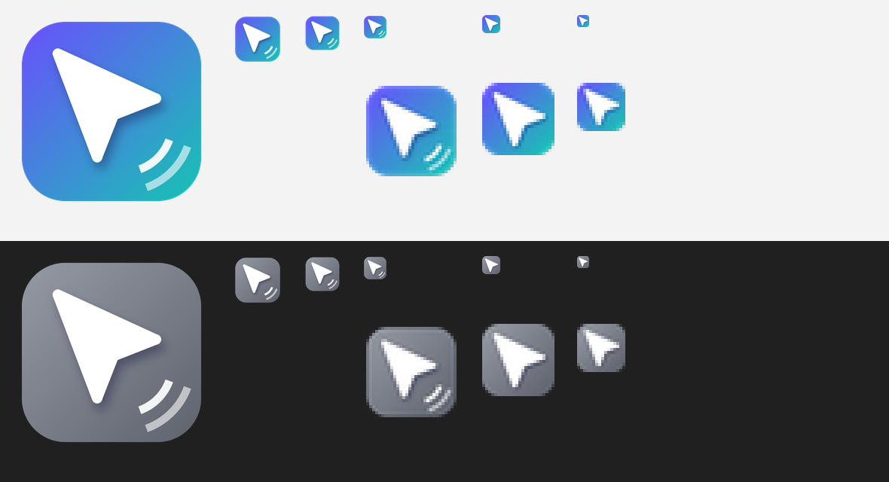

# Mowah

Mowah keeps Teams and similar programs "online" and stops the computer from going to sleep or locking, without getting in the way while you work. It runs on Windows and on the Mac.



| | Windows | Mac |
|---|---|---|
| File | `Mowah.exe`, about 400 kB | `Mowah.app`, in `Mowah.dmg` |
| Requires | Windows 10 or 11 | macOS 14 or later, Apple silicon or Intel |
| Lives in | the system tray | the menu bar |
| Languages | Swedish and English | Swedish and English |
| Code | `windows/`, Rust | `macos/`, Swift |

Neither of them has an installer.

## How it works

Mowah does nothing as long as you use the mouse or the keyboard yourself. Only when you have been idle for a while (60 seconds by default) does it create a little activity, and it repeats that at random intervals until you are back.

| Setting | What it does |
|---|---|
| Method | How the activity is created, see below. |
| Circle size | How large a circle the visible pointer movement draws, 20–1000 pixels (300 by default). The size is scaled with the display's resolution. The field is only active for the visible pointer movement. |
| Start after being idle for | How long you must have been away before Mowah starts (5–240 seconds). |
| Repeat every | The shortest and longest time between actions (5–240 seconds). The time is picked at random within the interval. |
| Also left-click | Clicks where the pointer is after every action. Off by default, since a click can hit something you did not intend. |
| Prevent sleep | Asks the system not to put the computer to sleep. |
| Keep the display on | Asks the system to keep the display lit. |
| Only Mon–Fri between | Mowah rests outside these hours, so that you go "away" and the computer may sleep after work. |
| Start with Windows / Open at login | Starts Mowah when you log in. |
| Language | Follow system, Svenska or English. Following the system gives Swedish when the operating system is in Swedish and English otherwise. A change shows at once. |

The methods:

| Method | Windows | Mac |
|---|---|---|
| Invisible | The pointer moves one pixel and back. | A mouse event at the pointer's own position. Nothing moves. |
| Visible pointer movement | The pointer draws a circle for one to two seconds, and stops if you take the mouse. | The same. |
| Key | F15, a key no ordinary keyboard has. | A keyboard event that types nothing. A real key would end up in whichever program is in front. |

The times cannot be set higher than 240 seconds, because Teams marks you as away after five minutes.

Mowah also rests while the computer is locked. Sleep is still prevented then, but the display may turn off.

The Windows version has two more settings: "Start minimized in the system tray" and "The close button minimizes to the system tray". The Mac version has no main window and does not need them.

## Windows

The icon in the system tray is in colour when Mowah is active and grey when it is paused or resting. A left click opens the window. A right click gives a menu with Open Mowah, Pause, Pause for 1 hour and Exit.

Windows 11 hides new icons behind the arrow in the system tray. Drag the Mowah icon out from there if you want to see it all the time.

Only one Mowah runs at a time. If you start the program again, the window that is already there comes to the front.

- Settings: `%APPDATA%\Mowah\settings.ini`
- Autostart: the value `Mowah` under `HKEY_CURRENT_USER\Software\Microsoft\Windows\CurrentVersion\Run`

Clear "Start with Windows" before you remove the program, and the autostart entry goes away. The folder `%APPDATA%\Mowah` can then be deleted by hand.

Clicks and key presses from Mowah do not reach programs that run as administrator. Windows does not allow that for ordinary programs.

## Mac

Open `Mowah.dmg` and drag `Mowah.app` to the Applications folder before you start it. An app that is run straight from the disk image or from Downloads is started by macOS from a temporary place, and then neither the permission nor opening at login can find its way back to it.

Mowah shows as a pointer in the menu bar, with no icon in the Dock. The pointer is distinct when Mowah is active, fainter when it is paused or resting, and has a dot when it needs your help. The menu shows the status and has Pause, Pause for 1 hour, Settings and Quit Mowah.

**The Accessibility permission is required.** macOS lets no program create mouse or keyboard activity without it. The first time, the settings window opens with a button that brings up the system's question. Then turn Mowah on under Privacy & Security › Accessibility in System Settings. Without the permission Mowah can keep the Mac awake, but not keep you "online".

- Settings: the app's own preferences in macOS, `com.freberdev.mowah`
- Opening at login: shown under General › Login Items in System Settings

The language list changes Mowah's own texts. The system's own dialogs, such as the question about the Accessibility permission, always follow the language of the Mac.

## Building

The Windows app, on macOS or Linux with `rustup` and `mingw-w64` installed:

```bash
rustup target add x86_64-pc-windows-gnu
windows/build.sh
```

The result ends up in `dist/Mowah.exe`. On Windows you can also run `cargo build --release` in the `windows` folder.

The Mac app, on a Mac with Xcode and XcodeGen:

```bash
macos/build.sh
```

The result ends up in `dist/Mowah.dmg`. The Xcode project is generated from `macos/project.yml` and is not kept in git.

Tests of the logic, that is, when Mowah should act, the settings, the schedule and the texts:

```bash
cd windows && cargo test
```

```bash
cd macos/MowahCore && swift test
```

That every text in the Mac app exists in both languages is checked with:

```bash
python3 tools/check_strings.py
```

In the Windows app the two languages are two sets of texts with the same fields, so a text that is missing in one of them does not compile.

The icons are drawn by `tools/make_icons.py` (requires Pillow), for both apps.

## Releasing a new version

Releases are built on a Mac and uploaded with `gh`. The Mac needs the Developer ID certificate and the notarisation credentials in its keychain.

First change the version number in `windows/Cargo.toml` (`version = "1.2.1"`) and run `cargo build` there once so that `Cargo.lock` follows. Both apps take their version from there. Commit and push to `main`.

Then build both files and upload them:

```bash
windows/build.sh
```

```bash
MOWAH_SIGN_IDENTITY="Developer ID Application: Name (TEAMID)" macos/release.sh
```

```bash
tools/check_version_tag.sh v1.2.1
```

```bash
gh release create v1.2.1 dist/Mowah.exe dist/Mowah.dmg --target main --title "Mowah v1.2.1" --generate-notes
```

`macos/release.sh` signs the app and the disk image, sends them to Apple for approval and staples the approval to both. `tools/check_version_tag.sh` says so if the tag is not the version in `windows/Cargo.toml` with a `v` in front. `gh release create` creates the tag and the release in one step.

## Signing

The Mac app can be signed with a Developer ID. The Windows app is not signed with any publisher certificate.

**Windows.** Mowah asks for no administrator rights, installs no keyboard or mouse hooks, and contains no packed or hidden code. If the file is downloaded from the internet, Windows SmartScreen may still warn about an "unknown publisher". A file you have built yourself or copied over directly does not normally get that warning. On a work computer with a locked-down application policy, unsigned programs may be blocked regardless.

**Mac.** An app built with `macos/release.sh` is signed with a Developer ID and approved by Apple, and opens without a warning. An app built with `macos/build.sh` without a certificate is only signed to run locally. That means:

- A downloaded app is stopped the first time. Approve it under Privacy & Security in System Settings.
- The Accessibility permission belongs to the exact file. After a new version it may have to be removed from the list and given again.

`macos/build.sh` signs with the identity in the environment variable `MOWAH_SIGN_IDENTITY`.

If you build the app yourself, you can avoid the second point by writing the name of your own development certificate on the first line of the file `macos/signing-identity.local`, which is not kept in git. macOS then recognises the app by the certificate instead of by the exact file, and the permission stays between builds. Such an app is meant for your own Mac and should not be handed out.

## How the code is laid out

- `windows/src/core/` and `macos/MowahCore/` – the logic, with no system calls: the engine that decides when something should be done, the settings, the schedule and the choice of language. It is the same logic in two languages, and everything here has tests.
- `windows/src/win/` – the window, the tray icon, the timer and the calls to Windows.
- `windows/res/` – icons, the manifest and the layout of the window (`mowah.rc`).
- `macos/Mowah/` – the menu bar, the settings window and the calls to macOS. The texts are in `Resources/Localizable.xcstrings`.
- `tools/` – the scripts for icons, texts and the version check.

## License

Mowah is released under the MIT license. The full text is in [LICENSE](LICENSE).
